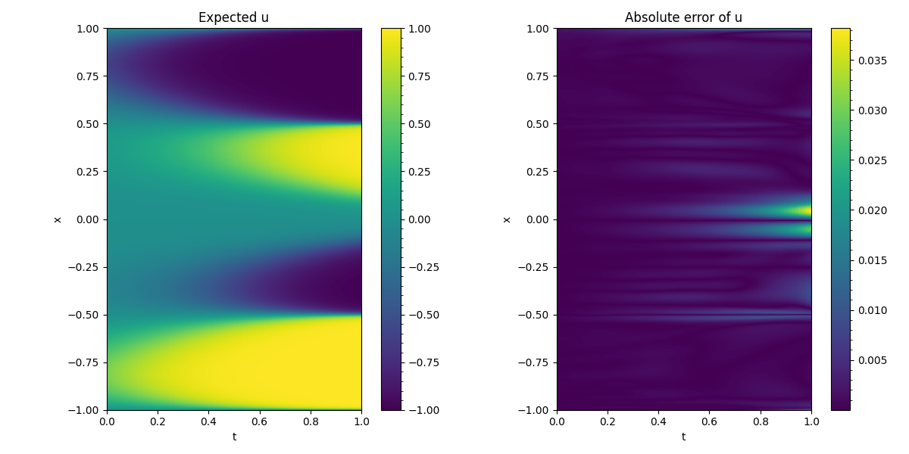
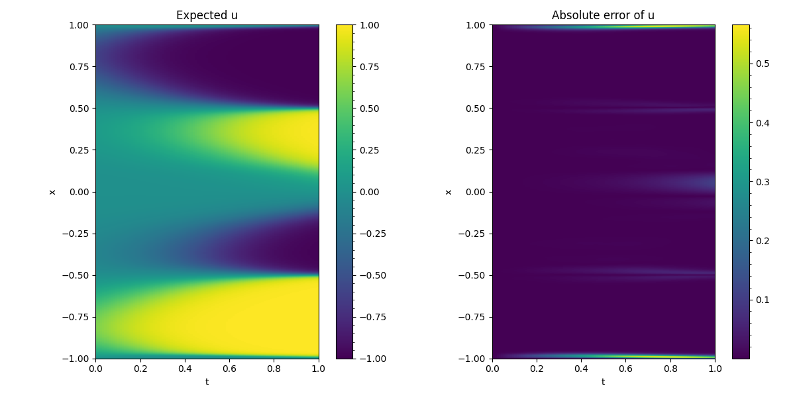
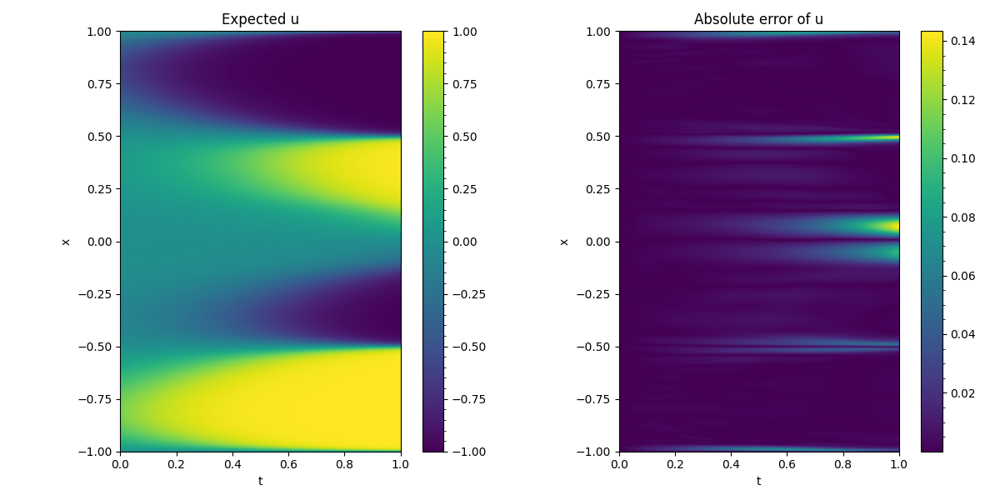

# Allen-Cahn System Equations Simulation to Find Exact Solution by PINN

### This is repository on result of the paper:

Kevin Buck, Woojeong Kim, Auto-Adaptive PINNs with Applications to Phase Transitions, Numerical Mathematics, Theory, Methods and Applications (Accepted; forthcoming in Vol. 19, 2026). [arXiv](https://arxiv.org/abs/2510.23999):2510.23999 

## Abstract of the paper

We propose an adaptive sampling method for the training of Physics Informed Neural Networks (PINNs) which allows for sampling based on an arbitrary problem-specific heuristic 
which may depend on the network and its gradients. In particular we focus our analysis on the Allen-Cahn equations, attempting to accurately resolve the characteristic interfacial 
regions using a PINN without any post-hoc resampling. In experiments, we show the effectiveness of these methods over residual-adaptive frameworks.

## Error Results

The following figures compare the whole-domain prediction error for three different sampling strategies applied to the Allen-Cahn problem.

### 1. Auto-Adaptive PINN

The proposed **Auto-Adaptive PINN (AA-PINN)** achieves the most accurate prediction over the whole domain, especially near sharp interfacial regions where standard PINN methods usually struggle.

  

### 2. Baseline PINN

The **baseline PINN** shows larger prediction errors across the domain, indicating that uniform sampling is less effective in resolving important localized structures.

  

### 3. Loss-Adaptive Sampling

The **loss-adaptive sampling** method improves upon the baseline approach, but still produces larger errors than the proposed AA-PINN in critical regions.

  

## Comparison Summary

- **AA-PINN** provides the best overall accuracy on the whole domain.
- **Baseline PINN** has the largest error among the three methods.
- **Loss-adaptive sampling** improves accuracy compared with the baseline, but remains less effective than AA-PINN.

These results show that the proposed auto-adaptive sampling strategy is more effective for capturing the sharp transition structure of the Allen-Cahn equation without requiring post-hoc resampling.
